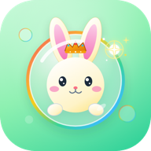

<p align="center">
  
</p>

<h1 align="center">彩虹小队 · 森林大解救</h1>

<p align="center">
  <strong>伸出食指，戳破彩虹泡泡，把动物朋友送回家。</strong><br>
  纯端侧 AI 视觉识别 · 亲子体感体态互动 · 原生 3D 动物与场景 · 多端横竖屏自适应
</p>

<p align="center">
  <a href="https://mfcheer.github.io/camGame/"><strong>🎮 立即在线体验</strong></a> ·
  <a href="https://github.com/mfcheer/camGame/actions/workflows/pages.yml">🚀 自动部署状态</a> ·
  <a href="https://github.com/mfcheer/camGame/actions/workflows/pages.yml"></a>
</p>

---

## 📖 项目简介

**《彩虹小队 · 森林大解救》** 是一款面向家庭亲子场景的轻量体感互动网页游戏。无需任何穿戴设备或手柄，只需一台带摄像头的手机、平板或电脑，玩家站在镜头前伸出食指，即可隔空触碰空中漂浮的彩虹泡泡，将充满爱心的彩虹能量注入动物朋友体内，帮助它们松绑回家。

游戏基于 **Three.js** 与 **MediaPipe** 构建，所有图像视觉算法均在**浏览器本地端侧**执行，零视频数据上传，守护家庭与儿童隐私。

---

## ✨ 核心特色与最新玩法

### 看图听单词

词库现有 **75 个去重词条**，包含幼儿园绘本《Toys》《Two》的18个核心词。绘本中的复数统一为单数词条（如 blocks → block、cats → cat），原书词形仍可作为别名查找；详细来源与素材见 [绘本词汇导入说明](docs/STORYBOOK_VOCABULARY.md) 和 [课程词库扩充说明](docs/VOCABULARY_EXPANSION.md)。

iPad 11英寸等平板采用更大的泡泡，横竖屏保持相同大小基准，图片与命中范围同步放大。所有类型均一次有效触碰就破；果冻与爱心保留外观和奖励，不再要求二次命中或双人就绪。

默认自由玩：保留图片泡泡、破裂声与动物反馈，不自动读词；开场没有自动问候，告别时动物会随机说一句短语（Thank you / Goodbye 等，含中英字幕）。免触碰开局为自动 3-2-1 倒计时，**合成音 / 中文人声 / 英文人声三套随机轮换**。戳破立即给动物充能，约450ms后出下一颗泡泡。每局锁定一张词卡贯穿全部泡泡（主题池保证相邻局不重词）。首页可开启“自动听英语”，记住家长选择；开启后每轮同一张词卡读**一英一中各一次**（先后顺序随机，中文用婷婷标准录音），第一次发音距离上一段语音结束至少12秒有效游玩时间，轮内成对的第二次只需2.5秒巩固间隔。繁忙时跳过机会，不排队补读；播报时同步显示对应图片词签（含中文）。各动物目标能量为偶数，从 6 起步逐个 +2。最后一击后动物带来一段开心小演出；拍照由家长手动选择。

点击词签或右上角小书本可主动暂停，查看完整词卡、点图片听英文，或点“听中文和英文”完整学习，再点“继续玩”。关闭自动英语也能点读。点右上角💬听动物说一句。适配手机横竖屏，切后台停音并保留进度，返回点继续，不自动补播或重播。首页词库入口仍可随时看图点读。规则与验收见 [自由玩与主动英语](docs/FLOW_LEARNING.md)。

### 1. 🎈 趣味特殊机制泡泡体系
告别单一单点交互，新增多层次物理与合作机制泡泡：
- **Q 弹果冻大泡泡**：半透明软弹果冻外观，一次触碰立即破裂，伴随“Duang~”音效和水滴粒子，注入 **+2 份充能**。
- **彩虹流光泡泡（连击奖励）**：Combo 连击达成 2 连击以上概率刷出，带七彩旋转色轮光晕；触碰触发清脆空灵的水晶滑音并绽放 24 颗微星雨。
- **亲子爱心泡泡（双人模式专属）**：粉色与蓝色爱心组成装饰，任一玩家碰任一侧或中间图片一次即破，提供 **+2 份充能**。

### 2. 📸 胜利抓拍“拍立得”纪念合影
- 仅在真实摄像头已开启、视频正常播放时显示；鼠标/触屏模拟或无摄像头时，直接展示紧凑解救成果，隐藏照片、拍照倒数、保存/重拍和虚拟头饰；
- 通关后动物会先在台前表演一段开心小演出，再挥别离开，并保留戴帽子庆祝；默认直接展示成果。仅手动点击「拍张合影」后才开始倒数，抓拍时播放快门与轻微闪光；
- 拍照倒数可随时取消；主动拍摄后保留成果，方便欣赏、保存或继续玩；
- Canvas 在场景渲染后抓拍玩家佩戴 3D 奖励头饰（皇冠、花环、探险帽）的精彩瞬间，合成一张 640×760 复古拍立得风格的**“森林英雄纪念卡”**；
- 摄像头和 AR 画面使用同一视口裁剪，完整保留横竖屏可见区域，避免头饰与人脸错位；
- 支持「再拍一张」，附带小动物徽章贴纸与通关时间戳；支持点击下载，或在浏览器支持时长按图片保存。

### 3. ⏳ 智能驻留倒计时
- 结算展示后约 **5 秒**自动随机遇见下一位朋友，想多看一会儿随时可留；
- **触摸即驻留**：触碰弹窗任意区域或点击「保存合影」，立即永久冻结自动跳转，切换为常驻提示：“*合影已为你保留，想玩时点击「再玩一次」*”；
- 发起下载后显示“*已发起下载 · 可再次下载*”，不把浏览器下载请求当作已经存入相册；
- 玩家离场会停止自动续局；重拍会保留结果。新增「随机下一位」，自动与手动随机都避开当前动物。

### 4. ⛺ 纯本地森林营地图鉴
- 首页集成「我的小营地」入口，实时显示点亮进度（如 `3/6`）；
- 基于纯本地 `LocalStorage` 记录 6 位动物朋友的解救状态与累计获救次数；
- 未解救的显示神秘剪影，已点亮的高光呈现；点击图鉴卡片可互动播放专属拟声与 Q 弹动效；
- **横屏一屏全景展示**：在矮视口横屏下自适应为 1 行 6 列（窄屏 2 行 3 列），Header 单行收敛，无需滚动一览无余。

### 5. 📱 全设备全尺寸横竖屏极致适配
- 完美覆盖电脑桌面 (1280×720)、平板 (1024×768)、长窄手机竖屏 (390×844、320×932) 及超短手机横屏 (844×390、568×260)；
- 泡泡与 3D 角色严格收敛在可视投影安全包围盒内，绝不出屏、不遮挡顶部 HUD 与底部跑道；
- 横屏下结算弹窗采用响应式双列分栏，杜绝任何纵向拉伸与压扁。

---

### 无文字动作示范

首次碰泡泡时会出现半透明食指和移动轨迹，示范随目标定位，真实手指靠近时让开；示范本身不计分。暂停会冻结并隐藏示范，横竖屏旋转后重新定位。

### 6. 六种动物，六种游玩节奏

每局第一颗泡泡保持安稳，从第二颗开始呈现不同玩法，操作始终是用食指触碰。

| 动物 | 玩法节奏 |
| :--- | :--- |
| 小兔 | 大一些、位置集中的安稳目标，适合入门 |
| 青蛙 | 小跳后长时间停顿，中途出现软弹果冻 |
| 橘猫 | 缓慢漂移，练习观察和跟随 |
| 小狗 | 轻快小弹动、较短出场间隔、宽松的连击窗口 |
| 飞龙 | 云间弧线移动，混合果冻与彩虹泡泡 |
| 金龙 | 舒缓的祥云曲线，较早遇见彩虹目标 |

- 手指靠近时，移动泡泡停在当前位置；所有泡泡均一次有效触碰即破。
- 久未命中或长时间接近未成功时，逐渐放慢、减少摆动并放大；连续顺利后只缓慢恢复，不突然加速。
- 暂停不消耗玩法与困难辅助时钟；旋转保留节奏和当前目标，重新开始重置本轮辅助。
- 双人模式保留左右归属与同心泡泡，不需要学习新手势。

### 7. 指尖反馈与动物回应
- 普通、果冻与双人爱心统一使用有效的可见指尖坐标；过期或推测的指尖不触发命中；
- 指尖外环保留玩家身份色，中心随局部背景调整对比；接近、接触、破裂有分层反馈；
- 果冻与爱心均无二次触碰或双人就绪门槛；特殊爱心任一参与玩家均可碰破；
- 旋转保留当前目标与进度，布局切换后有短暂保护；合作短暂遮挡宽限，持续缺人时保留进度等待归队；
- 六种动物会关注目标、追随能量、看向玩家回应，并有各自的预备动作与表情。

### 8. 解救后，看一段开心小演出

动物解救后会自己走到画面中央的舞台，**自动表演一段开心小演出**——全程无需任何操作，孩子和家长可以歇口气：

- 每局随机表演 **4-5 个动作**（约 10-14 秒），结尾以一个深深鞠躬加满屏爱心谢幕；
- 动作库共 **17 个**：欢跳、转圈、鞠躬、摇摆舞、大笑、挥手、果冻抖动、星星跳、点头打拍子等通用动作，加上每只动物的两个专属招牌——小兔冲天跳、橘猫甩尾、小狗歪头杀、青蛙飞跃、飞龙悬停振翅、金龙腾云漂浮；
- 每个动作开始都有一声该动物专属的"开心"音效并飘出爱心，同一动物每次登台的节目单都不重样；
- 右下角保留「和朋友说再见」按钮，想直接进入下一局可随时点击跳过；
- 演出不增加解救能量，不重复计算营地记录；暂停冻结，旋转后自动重新居中。演出结束后照常戴帽挥别；开启摄像头时可合影，未开启时直接展示成果。

## 🐾 六位动物朋友

| 动物 | 目标能量 | 动作与个性 | 叫声特征 |
| :--- | :---: | :--- | :--- |
| **小兔 萌萌** | 6 | 转耳、歪头、蹬腿兔跳回森林 | 清脆小吱叫 |
| **青蛙 呱呱** | 8 | 鼓起声囊、张手、蓄力大跳跃 | 软萌蛙鸣呱呱 |
| **橘猫 橘子** | 10 | 杏仁眼、慢眨眼、伸懒腰、轻步快跑 | 撒娇小猫咪呜 |
| **小狗 旺旺** | 14 | 歪头吐舌、兴奋摇尾奔跑 | 欢快小汪汪 |
| **金龙 小金** | 12 | 金黄背脊、长须微摆、点头游动 | 祥瑞小龙鸣 |
| **飞龙 翼翼** | 16 | 展翅扑翼、抬头长啸、低空滑翔 | 空灵龙吟 |

- **五套动态随机场景**：森林花径、溪边栈道、秋日果园、竹林石径、云上花园，每局随机轮换且自带对应主题乐曲。

---

## 🎮 怎么玩

1. **进入游戏**：用浏览器打开 [在线游戏](https://mfcheer.github.io/camGame/)，挑选一位喜爱的动物，或点击“随机朋友”；
2. **选择模式**：选择“单人探索”或“亲子合作”，允许摄像头权限；
3. **身体就位**：站在摄像头前，后退约 1.5~2 米让上半身和双手进入画面，保持食指自然抬起，等待 3 秒倒计时；
4. **戳破泡泡**：伸手用指尖光点触碰泡泡，普通、彩虹、果冻和爱心均一次即破；
5. **通关庆祝**：动物解救成功后先表演一段开心小演出，再戴帽子挥别；开启摄像头时可手动点击「拍张合影」留念，点击「再玩一次」开始下一局。

> 💡 **没有摄像头也能玩**：支持点击「电脑鼠标/触控板模拟体验」，通过鼠标滑动即可无门槛体验戳泡泡全部乐趣！

---

## 🔒 隐私与安全性

- **全端侧处理**：基于 Google MediaPipe Pose & Hand 实时视觉模型与 WebAssembly 引擎，全部特征点计算完全在您本地设备的 CPU/GPU 内存中完成；
- **绝不上云**：应用不包含任何后端服务器接口，绝不录制、持久化或上传玩家的任何视频、照片或人脸数据；
- **拍照纯本地**：生成的拍立得照片仅在浏览器本地 Canvas 内存中绘制，点击保存时直接由浏览器下载到本地相册或硬盘。

---

## 🛠️ 本地开发与构建

本项目仅需兼容的 Node.js 20+ 环境。

```bash
# 1. 安装依赖
npm ci

# 2. 启动本地开发服务 (带本地模拟与摄像头支持)
npm run dev:local       # 打开 http://127.0.0.1:5175/

# 3. 运行全量自动化测试套件 (47 套测试套件覆盖核心逻辑与布局规范)
npm test

# 4. 构建生产产物
npm run build           # 打包输出至 dist/

# 5. 本地预览生产构建产物
npm run preview
```

---

## 🚀 GitHub Pages 一键自动部署

仓库已接入 GitHub Actions 自动化工作流（`.github/workflows/pages.yml`）：
- 每次将代码推送到 `main` 分支时，工作流将自动执行依赖安装、测试验证、Vite 生产打包并发布至 GitHub Pages；
- 部署成功后，即可直接在 **https://mfcheer.github.io/camGame/** 访问最新版本。

---

## 🎨 应用图标与资源架构

- **应用矢量图标**：`public/icons/app-icon.svg`（薄荷森林底色、立体彩虹气泡、头戴金冠小兔与食指触碰星光）；
- **全尺寸导出脚本**：`node scripts/build-icons.mjs`，自动导出 `icon-512.png`、`icon-192.png`、`apple-touch-icon.png` (180×180) 与 `icon-32.png`；
- **PWA 清单**：`public/manifest.webmanifest`，支持手机/平板浏览器“添加到主屏幕”作为独立 Web App 运行。

```text
camGame/
├── public/
│   ├── icons/            # SVG 与各分辨率应用图标
│   ├── models/           # 6 种动物 3D GLB 资产及表情贴图
│   ├── vendor/           # MediaPipe 本地离线库
│   ├── wasm/             # WebAssembly 视觉推理引擎
│   └── manifest.webmanifest
├── src/
│   ├── main.js           # 游戏主状态机循环与生命周期管理
│   ├── bubbleManager.js  # 泡泡生成、Q弹果冻/彩虹/双人同心特殊泡泡与碰撞
│   ├── happyPerformance.js # 解救后开心小演出：随机动作编排、招牌绝活与谢幕
│   ├── polaroidManager.js# 胜利抓拍、Canvas 画布合成与相片导出
│   ├── campManager.js    # 本地 LocalStorage 营地图鉴持久化
│   ├── uiManager.js      # HUD、倒计时、模态框与全端交互
│   ├── poseDetector.js   # MediaPipe 手部与人体关键点本地解算
│   ├── audioManager.js   # Web Audio API 程序化音效与分场景 BGM
│   └── style.css         # 全端响应式样式、横竖屏自适应与动画
├── test/                 # 47 套全方位自动化集成测试套件
└── scripts/              # 3D 资产重编译与图标渲染构建工具
```

新增老师日常练习中的8个看图词与动物简短英文句库；当前版本通过游戏右上角💬主动点听，不在每轮开场和告别自动播放。内容筛选与短句清单见 [课堂词汇与动物口语](docs/CLASSROOM_PHRASES.md)。

首页「单词小花园」支持按分类看图、点击听一次英文；不需要摄像头。动物短句使用离线生成的自然语音，字幕保留跟读时间，可点「再听一次」；泡泡与挥别动作并行，不等字幕结束。模拟游玩已拦截横向触控板滚轮手势；词库保留正常纵向滚动。

配音维护入口：[配音制作与验收规范](docs/VOICE_STANDARD.md)。智能体先读 [AGENTS.md](AGENTS.md)，英文统一使用已验收的Kokoro af_heart/0.92流程，定向生成并保留制作清单。
