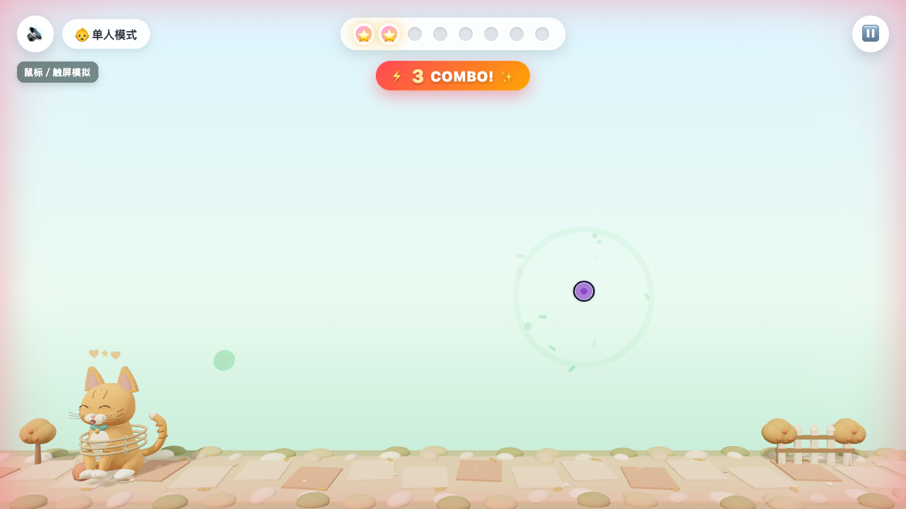
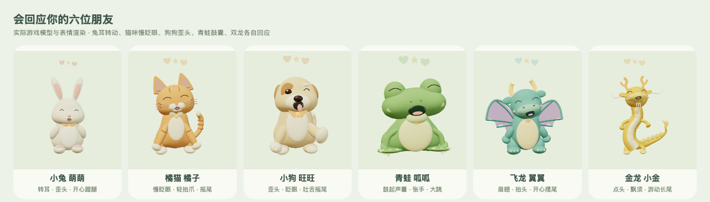

<p align="center">
  
</p>

<h1 align="center">彩虹小队 · 森林大解救</h1>

<p align="center">伸出食指，戳破彩虹泡泡，把动物朋友送回家。</p>

<p align="center">
  <a href="https://mfcheer.github.io/camGame/"><strong>🎮 打开游戏</strong></a> ·
  <a href="https://github.com/mfcheer/camGame/actions/workflows/pages.yml">🚀 一键发布</a> ·
  <a href="https://github.com/mfcheer/camGame/actions/workflows/pages.yml"></a>
</p>



## 怎么玩

1. 用浏览器打开 [在线游戏](https://mfcheer.github.io/camGame/)，选一位动物，或选“随机朋友”。
2. 选择单人探索或亲子合作，点击开始并允许摄像头；站在镜头前，让脸和双手进入画面。
3. 伸出食指，用指尖光点碰泡泡。能量飞到动物身上后，它会回应并逐步松开绳子。
4. 收集够泡泡，观看动物回家和随机头饰奖励。结算后5秒自动随机下一轮，也可选择“先休息”。

没有摄像头也能玩：点击“电脑鼠标/触控板模拟体验”，移动鼠标碰泡泡。手机和平板支持横竖屏自动适配；摄像头应在支持相应能力的浏览器中通过HTTPS访问。

## 手机屏幕适配

横竖屏均可直接玩，旋转不会打断本轮。小屏首页保持开始按钮可见，动物区独立滚动；12格能量条、弹窗和底部跑道会避让浏览器工具栏及屏幕安全区域。详细验证范围见[手机布局记录](design-review/MOBILE_LAYOUT_DELIVERY.md)。

## 六位动物朋友

| 动物 | 泡泡数量 | 个性与动作 |
| --- | ---: | --- |
| 小兔 萌萌 | 5 | 转耳、歪头、蹬腿兔跳 |
| 青蛙 呱呱 | 6 | 鼓起声囊、张手、蓄力大跳 |
| 橘猫 橘子 | 8 | 杏仁眼、慢眨眼、抬爪、四足轻跑 |
| 金龙 小金 | 9 | 黄背脊、长须长尾、点头游动 |
| 小狗 旺旺 | 10 | 歪头、眨眼吐舌、摇尾奔跑 |
| 飞龙 翼翼 | 12 | 扇翅、抬头、低空滑翔 |



- **每轮不同风景**：森林花径、溪边栈道、秋日果园、竹林石径、云上花园，开局随机且避开上一套。
- **轻松互动**：指尖随局部背景调整对比度；连击只计算泡泡可戳时的时间，不扣生成冷却和保护期。
- **动物会回应**：笑眼、目光跟随、各自动作、短时爱心和星光；六种动物拟声和五套场景音乐。
- **成功仪式**：随机珠宝皇冠、花叶环或探险帽，摄像头模式下跟随选定玩家头部。
- **暂停与重开**：暂停冻结动物和进度；支持声音开关、退出和切换人数。

## 摄像头与隐私

人体和手部识别使用本地运行的 MediaPipe Pose Landmarker 与 Hand Landmarker，交互使用21点手模型的8号食指尖。视频帧仅在设备内存中处理，应用不录制、不持久保存、不上传摄像头影像。首次打开需要下载页面、模型和WASM运行库；GitHub Pages负责托管这些静态文件。

手指完全出画或被遮挡时无法保证识别。请留出活动空间，由家长陪同儿童体验；真实设备的跟踪效果和帧率取决于摄像头、光线及硬件。本项目没有后端、账号或付费功能。

## 本地开发

需要 Node.js 22.12+ 或更新的兼容版本。

```bash
npm ci
npm run dev:local       # http://127.0.0.1:5175/，可用于本机摄像头
npm test                # 145项模块检查
npm run build           # 生产构建到 dist/
npm run build:assets    # 从模型源重新导出六种GLB
```

`npm run dev`保留局域网HTTPS开发模式。生产地址使用GitHub Pages提供的HTTPS，访问者不需要安装Node.js或下载源码。

## 一键发布到 GitHub Pages

当前仓库已配置 `.github/workflows/pages.yml`，采用GitHub官方Pages Actions工作流：

- **自动更新**：把修改提交并推送到`main`，自动安装依赖、运行测试、构建并发布。
- **手动发布**：打开 [发布工作流](https://github.com/mfcheer/camGame/actions/workflows/pages.yml)，点击 **Run workflow → Run workflow**。
- **分享链接**：发布成功后直接分享 **https://mfcheer.github.io/camGame/**。

首次为其他仓库启用时，到 **Settings → Pages → Source** 选择 **GitHub Actions**。工作流按仓库名设置Vite部署子路径，模型、识别Worker和图标均跟随该路径。无需额外配置服务器、上传`dist`或把构建产物提交到分支。

如需在本地验证本仓库的部署路径：

```bash
VITE_BASE_PATH=/camGame/ npm run build
CAMGAME_HTTP=1 VITE_BASE_PATH=/camGame/ npm run preview -- --host 127.0.0.1 --port 4175
# 打开 http://127.0.0.1:4175/camGame/
```

## 应用图标与主屏幕

图标采用“彩虹泡泡里的小兔”，与游戏的薄荷绿、奶油白和彩虹配色一致。

- 可编辑SVG：`public/icons/app-icon.svg`
- PNG：32、192、512像素；Apple Touch图标：180像素
- `public/manifest.webmanifest`提供应用名称、启动地址和主屏幕图标；可通过支持的浏览器菜单添加到主屏幕。本项目不承诺离线运行。

## 项目结构

```text
src/                      游戏、识别协调、音效、3D模型与动作源
public/models/            六种动物GLB、预览图与识别模型
public/wasm/              本地MediaPipe WASM运行库
public/vendor/            本地识别脚本及来源许可
public/icons/             SVG与多尺寸应用图标
public/tracking-worker.js 独立识别线程
.github/workflows/        自动测试、构建与Pages发布
scripts/                  模型导出和视觉预览工具
test/                     模块与浏览器检查
design-review/            各版本的实现与验收记录
```

技术栈：Three.js、MediaPipe、Web Audio API、Vite。角色、场景、图标为项目内可编辑资产；第三方运行库的来源与许可见`public/vendor/`。详细实现和验证边界见 [v0.14交付记录](design-review/V14_DELIVERY.md)，早期README已移至 [历史说明](docs/README_HISTORY.md)。
