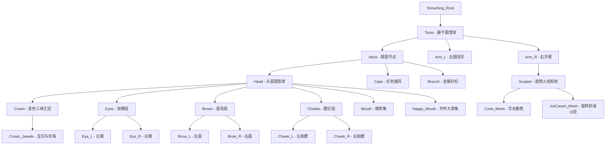

# 蜜雪冰城雪王：角色动作卡与视觉规范

> 2026-11-21，按用户要求为《彩虹小队》新增「蜜雪冰城雪王」（`snowking`）卡通角色。本文件定义视觉识别锚点、几何视角与防遮挡规范、骨架层级、逐泡反应、招牌动作、专属收尾、终点告别与红白金配色方案，作为后续 3D 建模与全流程游戏接入的设计准则。视觉概念稿见 [`design-review/snowking-concept.svg`](file:///Users/mfcheer/code/camGame/design-review/snowking-concept.svg) 及其高清预览图。

---

## 一、 角色动作卡核心规格

| 项目 | 设计依据与规范要求 |
| :--- | :--- |
| **角色唯一标识** | 内部 ID：`snowking`，中文显示名：「雪王」（蜜雪冰城朋友），英文名：Snow King。目标能量：8 份。 |
| **识别锚点** | 经典两球圆滚白雪人身躯（头圆身胖）、头顶立挺金色三峰皇冠（嵌三颗珍珠与红宝石）、身披鲜艳大红披风系带金色领结、手持标志性冰淇淋华夫甜筒火炬权杖。缩小至首页选择头像（384×384）或小尺寸营地徽标（48×48）仍能一眼辨识。 |
| **几何视角与防遮挡** | **基准朝向视角**：默认采用 3/4 等轴透视角度（`SNOWKING_BASE_ROT_Y = 0.52` rad，约 30°~35°），凸显立体圆润雪球身躯，避免平视时圆身与四肢扁平。 **权杖外展零遮挡**：右臂持甜筒权杖向右外侧展开约 35°（相对于身体中轴 x 偏置 0.40~0.55，z 偏置 0.15~0.25），离面部中心水平安全间距保持在 0.5 视口单位以上。行进、待机呼吸、受困挣扎与三段庆祝中段，甜筒权杖严禁横穿面部前方，确保面部五官 100% 暴露在镜头前。 **披风后置飘逸**：披风领口紧扣颈部后方，斗篷后片自然垂落并向左后方微舒，绝不向前包覆胸腹或遮掩面部。 **受困绳圈下移避让**：雪人体型上小下大，游戏开始木桩与困住绳圈必须下移至下身腹部中段（y ≈ 0.20~0.32），绝对不勒在脖颈或头部，让雪人头部五官、腮红与金冠清爽暴露在绳圈上方。 |
| **性格与运动方式** | 热情开朗、乐天友善、憨态可掬的甜蜜王者。没有细长腿部，移动采用萌趣雪人小碎步摇摆（Waddle & Bounce）：重心左右微倾各 8°~12°，身躯随节拍轻快微弹，两只圆手与甜筒权杖随步伐自然节奏性晃动。离场时小摇摆欢快碎步前行，不做动物跳跃或车辆轮滑。 |
| **眼神与面部表情** | 黑色大圆眼带双高光点，受困时眼神随目标泡泡和玩家指尖灵活注视；眉毛为黑色短萌弯眉，担心时内收微蹙，获救开心时扬起舒展；脸颊常驻通透蜜桃粉腮红（`Cheek_L`、`Cheek_R`）；微笑嘴微张，获救及兴奋时切换大开朗笑嘴（`Happy_Mouth`）。眨眼眼眶依附球形表面，杜绝穿模与脱离。 |
| **逐泡回应①「权杖轻扬」** | 右手甜筒权杖向上轻扬小幅抬起（约 15°），金冠伴随微颤，双眼大圆眼眨眼看向能量飞来方向（约 0.65 秒内完成，不延迟出泡）。 |
| **逐泡回应②「萌趣摇晃」** | 圆滚雪人身躯左右欢快轻倾摇晃各一拍（倾角约 ±10°），红色披风尾端随动微扬，圆手轻摆。 |
| **逐泡回应③「甜蜜点赞」** | 甜筒权杖向前平稳轻点一次，腮红微亮泛红，笑眼弯弯露出开心微张小嘴。三种逐泡反馈轮换触发，连击时强化光效与神态。 |
| **招牌庆祝一「甜蜜摇摆舞」** `snowkingWaltz` | 获救进入舞台中央，雪人踏着欢快三拍子节拍左右摇摆，右手持甜筒权杖如同指挥家般优雅随节拍小幅划出弧线，身后红披风如波浪般飘扬。 |
| **招牌庆祝二「冰爽火炬」** `snowkingTorch` | 双手向玩家高高举起甜筒权杖，皇冠顶部珍珠闪烁金光，圆滚雪人体在原地欢快连弹两下，传递冰爽欢庆能量。 |
| **专属收尾「雪王加冕」** `snowkingCoronation` | （独立 ID、`isFinale: true`）站稳舞台中央，右手执甜筒权杖向前平稳行致敬礼轻点，挺胸昂首，金冠上三颗珍珠与红宝石闪烁，红色斗篷随风舒展，全脸绽放元气大笑容，伴随红、白、金三色纸花与聚光灯齐放，随后平滑复位。 |
| **终点告别** `applyFarewellPose` | 欢快小碎步移动至右侧终点减速刹停，前叉式转身面向玩家，斜持甜筒权杖轻点两下致意，披风微扬，双眼向玩家眨眼并露出温暖不舍的道别微笑后淡出；不使用拟人化疯狂挥手或深鞠躬。 |
| **声音与色彩通道** | **声音**：严格遵循规范，不新增人声配音。音效复用现有欢快清脆的魔法铃音/叮当声通道（走现有 `audioManager` 音效总线）；解救对话复用已有已验收英文短句通道。 **庆祝配色**：红白金三色（雪王红 `#ff2535`、纯雪白 `#ffffff`、王冠金 `#ffc72c`）聚光灯与专属纸花。 |

---

## 二、 3D 模型骨架与节点命名约定（供建模与动作接入）

为确保后续 Three.js 原生模型、导出 GLB 以及动作骨架统一，模型层级必须严格按照以下标准节点规范命名：

---

## 三、 防遮挡与视口适配检查清单

1. **横屏视口（1194×834）与竖屏视口（834×1194）**：
   - 处于左侧起点（受困）时，下身腹部处于 y ≈ 0.20~0.32，木桩绳圈严禁压过 Neck（y=0.42）以上；
   - 处于舞台中央（获救庆祝）时，甜筒权杖处于画面偏右前方，与头部中心保持至少 0.5 视口宽度横向间距；
   - 处于右侧终点（告别）时，转身朝向玩家视角（约 -30°~-40°），甜筒权杖与披风轮廓分立。
2. **同源透明头像（`snowking-preview.png`）**：
   - 采用同源 3D 模型在 `scripts/model-preview.html` 渲染；
   - 视角统一采用 3/4 等轴透视角度（`ROT_Y = 0.52`，FOV = 28°），保证王冠三峰、甜筒权杖华夫纹与雪人体态完整容纳于 384×384 画布中，背景透明无裁切。
3. **动静与生命周期**：
   - 暂停与切后台时完全冻结姿态；
   - 减少动态效果模式下，摇摆倾角从 ±12° 缩小至 ±3°，权杖摆幅按比例收敛；
   - 动作结束与重新开始时，各骨架节点平滑清零复位（`resetPose`），避免残留旋转。

---

## 四、 交付与端到端自动化验收证据记录

### 1. 验证命令与退出码
- **专项测试套件**：`node test/qa_v55_snowking.mjs` -> 退出码 `0`（包含模型节点存在性、权杖安全间距、受困绳圈腹部避让、动作生命周期、双人协同与降级断言）。
- **全量回归测试套件**：`npm test` -> 55 套测试用例全数通过，退出码 `0`。三份既有 QA JSON 基线文件逐字节保全。
- **生产构建验证**：`VITE_BASE_PATH=/camGame/ npm run build` -> 构建打包通过，退出码 `0`。
- **端到端浏览器自然闭环验收**：`node scripts/accept-snowking.mjs` -> 退出码 `0`。

### 2. 自动化截屏目检凭证（位于 `output/playwright/snowking/`）
1. `01_landscape_playing.png`：横屏 iPad (1194×834) 受困待机游玩，双球饱满，金冠红斗篷，下腹绳圈不勒颈，甜筒权杖外展无遮挡；
2. `02_landscape_dialogue.png`：横屏问答阶段，自然碰破 8 颗泡泡触发问答题卡；
3. `03_landscape_farewell.png`：横屏终点点杖告别，雪王面向玩家眨眼微笑；
4. `04_landscape_victory_performance.png`：横屏开心小演出与胜利结算；
5. `05_portrait_playing.png`：竖屏 iPad (834×1194) 受困待机游玩；
6. `06_portrait_dialogue.png`：竖屏问答阶段互动；
7. `07_portrait_farewell.png`：竖屏终点点杖告别；
8. `08_portrait_victory.png`：竖屏开心小演出与胜利结算；
9. `09_glb_fallback_playing.png`：GLB 模型网络加载失败降级为原生 Three.js 模型（assetStatus: 'fallback'）；
10. `10_performance_stage_waltz.png`：舞台招牌庆祝一 `snowkingWaltz` 优雅左右三拍华尔兹中段姿态；
11. `11_performance_stage_finale.png`：专属收尾 `snowkingCoronation` 加冕致敬礼中段姿态。

### 3. 设备与硬件边界说明
本轮验收已在 Headless Chromium (Playwright) 环境完成真实视口尺寸仿真、真实鼠标滑动自然碰泡、问答点击、告别与结算完整闭环链路。真实 iPad 物理多点触控与真机摄像头 MediaPipe 追踪仍作为真机待验边界。
